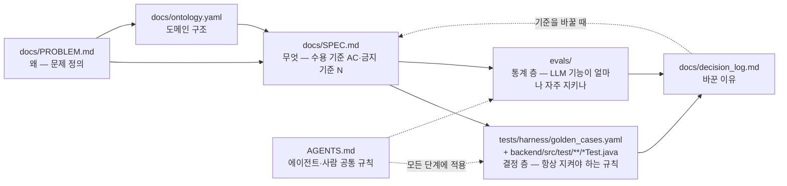

# 개발환경 설계 — 사람과 LLM 에이전트가 같은 규칙으로 일하게

> 외부 리뷰어용 안내. 이 저장소에서 "무엇을 만들지 → 어떻게 확인할지 → 왜 바꿨는지"가 어떤 파일로 이어지는지, 그리고 코딩 에이전트(Claude Code 등)가 그 규칙 안에서만 움직이도록 어떻게 묶었는지를 보여 준다.
> 모든 주장 옆에 출처 파일을 적었다. 2026-11-12 기준.

## 1. 한 장 요약

| 단계 | 파일 | 역할 |
|---|---|---|
| 왜 | [`docs/PROBLEM.md`](PROBLEM.md) | 인터뷰 근거의 문제 정의 |
| 무엇 | [`docs/SPEC.md`](SPEC.md) | 수용 기준(AC)과 6.1절 금지 기준(N1~N17). API 정본 |
| 도메인 | [`docs/ontology.yaml`](ontology.yaml) | 엔티티·관계의 정본. [`AGENTS.md`](../AGENTS.md) 2장은 어휘만 발췌 |
| 결정 층 | [`tests/harness/golden_cases.yaml`](../tests/harness/golden_cases.yaml) + 백엔드 테스트 | 케이스 106개, 테스트 메서드 이름 앞 id로 연결 — [`tests/README.md`](../tests/README.md) |
| 통계 층 | [`evals/EVAL_DESIGN.md`](../evals/EVAL_DESIGN.md), [`evals/run_evals.py`](../evals/run_evals.py) | LLM 기능(`parse`, `recheck`) 품질을 비율·합격선으로 측정 |
| 변경 근거 | [`docs/decision_log.md`](decision_log.md) | 스펙·기준을 바꾼 날짜·이유·결정자 |

## 2. AC 하나를 끝까지 따라가 보기 — AC8 (자유서술 파싱에서 지어내지 않기)

| 단계 | 내용 | 출처 |
|---|---|---|
| 스펙 | **AC8**: 자유서술 이슈 텍스트에 `screen`·`element`·`repro_steps`에 해당하는 내용이 없으면 지어내지 않고 비워 둔 채 `missing`에 담아 되묻는다. 금지 기준 **N9**: 파싱 API는 DB에 아무것도 쓰지 않고, 스키마 검증 실패 시 값을 만들어 내지 않고 실패로 응답 | [`docs/SPEC.md`](SPEC.md) AC8, 6.1절 N9 |
| 골든 케이스 | `pc-001` — repro_steps가 없으면 missing에 담아 되묻는다 / `ng-009` — 파싱 API는 이슈를 만들지 않는다 | [`tests/harness/golden_cases.yaml`](../tests/harness/golden_cases.yaml) |
| 테스트 | `ParseApiTest.pc001_재현_절차가_없으면_지어내지_않고_missing에_담는다`, `ParseApiTest.ng009_파싱은_이슈를_만들지_않는다` | `backend/src/test/java/com/acjb/server/controller/ParseApiTest.java` |
| 구현 쪽 검증 | LLM 출력을 받은 뒤 `IssueReportContext.schema.json`으로 검증(구조화 출력을 켜도 생략하지 않음) | `backend/src/main/java/com/acjb/server/parse/IssueReportContextSchema.java`, 정본 스키마 [`src/qating/schemas/IssueReportContext.schema.json`](../src/qating/schemas/IssueReportContext.schema.json) |
| 프롬프트 | 실패 모드 점검표와 필드 매핑 | [`src/qating/prompts/parse_query.md`](../src/qating/prompts/parse_query.md) |
| eval 지표 | `parse_format`(목표 100%), `parse_fabricated`(0건, 절대 규칙), `parse_missing_match`(≥90%), `parse_extraction`(≥90%) 등 — `parse` 케이스 18개 | [`evals/EVAL_DESIGN.md`](../evals/EVAL_DESIGN.md) 1절, [`evals/evalset.jsonl`](../evals/evalset.jsonl) |
| 최근 결과 | 실행 `2026-11-10T2312`: 형식 1.0, 지어낸 값 0, 되물음 일치 0.944, 추출 0.944, 인젝션 추종 0 | [`evals/results/history.csv`](../evals/results/history.csv) |

결정 층(테스트)은 "지어낸 값이 들어가면 한 번이라도 실패", 통계 층(evals)은 "실제 모델이 18개 입력에서 얼마나 자주 맞히는가"를 잰다. 같은 AC를 두 층이 다른 질문으로 본다.

## 3. 에이전트 규칙 구조

- **단일 정본은 `AGENTS.md`**: 제품 맥락, 용어집, 절대 규칙, 금지 사항, 코딩 컨벤션, 완료의 정의, 운영 정보를 한 파일에 둔다. 대상은 특정 도구가 아니라 "AI 코딩 에이전트(Claude Code, Cursor, Copilot 등)"다. — [`AGENTS.md`](../AGENTS.md) 머리말
- **`CLAUDE.md`는 `@AGENTS.md` import만 한다**: "어느 도구를 쓰든 같은 문서를 읽게 하기 위해서다. 여기에 규칙을 복제하지 않는다." — [`CLAUDE.md`](../CLAUDE.md)
- **에이전트는 테스트·기준을 고치지 못한다**: `tests/`와 골든 케이스 변경은 사람이 승인하고, 실패하면 테스트가 아니라 구현을 고치며, skip·xfail·케이스 삭제로 통과시키지 않는다. — [`AGENTS.md`](../AGENTS.md) 4장 1·2항. 이유는 위임 기록에 적혀 있다: "에이전트가 기준을 고치면 그 기준으로 결과를 판정할 수 없다." — [`docs/prompts/delegation_evals.md`](prompts/delegation_evals.md)
- **위임 범위 설계(evals 러너 사례)**: — [`docs/prompts/delegation_evals.md`](prompts/delegation_evals.md)
  - 러너(`evals/run_evals.py`)는 판정 기준을 실행하는 장치라 에이전트에게 맡겼다
  - 판정 기준(`EVAL_DESIGN.md`, `evalset.jsonl`, `judge_prompt.md`)은 위임 범위에서 뺐다
  - 사람이 저장된 출력에 **오답 9건을 주입**해 러너가 9건 모두 실패로 판정하는지 확인했고, 그 뒤로 러너는 에이전트가 임의로 고치지 않는다
- **완료의 정의는 실행 결과**: 관련 골든 케이스 통과, `./gradlew test`·`npm run build` 통과, "동작할 것 같다"가 아니라 실제로 실행한 결과를 근거로 삼는다. — [`AGENTS.md`](../AGENTS.md) 6장
- **모호하면 멈춘다**: 확인되지 않은 API 스펙을 추측해 구현하지 않고, 확인이 필요한 지점을 명시하고 멈춘다. — [`AGENTS.md`](../AGENTS.md) 4장

## 4. LLM 기능 설계 원칙

- **LLM은 위치·후보만, 값 계산·판정은 서버가 결정적으로**: 첫 QA 비교기에서 Figma 값은 노드 JSON에서 코드로 읽고, LLM은 컴포넌트 코드에서 그 요소를 그리는 줄과 토큰만 찾는다. 서버가 그 토큰이 실제로 그 줄에 있는지 확인하고, 저장소 CSS·Tailwind theme으로 직접 값으로 바꿔 비교한다. — [`docs/spikes/2026-11-10_first-qa-comparator.md`](spikes/2026-11-10_first-qa-comparator.md) "가정"
  - 이 분리 덕에 정밀도 82.5%(기준 90% 미달)의 원인을 가를 수 있었다: 틀린 후보 10개 중 9개가 LLM이 아니라 서버의 비교 규칙 문제였고, 규칙 3개 보완 뒤 독립 주입 실행에서 기준을 넘었다. 표본이 작아(노드 10개, 저장소 1개, Tailwind만) 일반화하지 않는다고 같은 문서에 적혀 있다
- **근거가 둘 다 있을 때만 저장**: `StyleMismatch`는 `expected_value`·`actual_value`가 둘 다 있을 때만 저장한다. — [`AGENTS.md`](../AGENTS.md) 3장 2항, [`docs/SPEC.md`](SPEC.md) N17
- **구조화 출력은 JSON Schema로 검증**: LLM이 돌려준 JSON은 받은 뒤 스키마(`required`·`additionalProperties: false`)로 검증하고, 벗어나면 파싱 실패로 처리한다. — [`AGENTS.md`](../AGENTS.md) 5장, `backend/src/main/java/com/acjb/server/parse/IssueReportContextSchema.java`, `backend/src/main/java/com/acjb/server/recheck/RecheckSuggestionSchema.java`
- **코드로 잴 수 있는 것은 judge에게 맡기지 않는다**: 스키마·지어낸 값·missing·근거 id·재현율은 코드 채점, judge는 의미 판단 세 기준에만. — [`evals/EVAL_DESIGN.md`](../evals/EVAL_DESIGN.md) 1절 원칙

## 5. 알려진 한계

| 한계 | 상태 | 출처 |
|---|---|---|
| CI 미구성 | `.github/workflows/`가 없다 — 테스트·빌드는 사람·에이전트가 로컬에서 돌린다 | 저장소 `.github/` |
| 프론트 테스트 없음 | `frontend/package.json`에 `test` 스크립트가 없고 테스트 파일도 없다. 확인은 `npm run build`(타입 검사)·`npm run lint`와 브라우저 확인뿐 | [`frontend/package.json`](../frontend/package.json) |
| evals `p07` 실패 | 3회 실행 모두 같은 실패 — 데이터셋 기대값(element="글자")이 프롬프트의 element 정의와 어긋남. 사람 결정 대기 | [`evals/EVAL_DESIGN.md`](../evals/EVAL_DESIGN.md) |
| judge 사람 라벨 미작성 | `evals/judge_labels.jsonl`이 비어 있다 — judge 지표 3개는 라벨로 검증하기 전까지 참고값 | [`evals/EVAL_DESIGN.md`](../evals/EVAL_DESIGN.md), [`evals/judge_labels.jsonl`](../evals/judge_labels.jsonl) |
| 첫 QA·비교 분석은 evals 밖 | Figma API·GitHub를 실제로 읽어야 해서 러너로 재현할 수 없다. 근거는 스파이크의 1회 측정값뿐이고, 고정 입력 스냅샷으로 넣는 것이 v2 백로그 | [`evals/EVAL_DESIGN.md`](../evals/EVAL_DESIGN.md) 0절 |
| 골든 케이스 16개가 테스트와 id로 연결되지 않음 | id 중복 1건(`nt-007`) 포함 | [`tests/README.md`](../tests/README.md) |

<!-- TODO(설만수): 수업 지침에서 온 부분과 팀이 직접 설계한 부분 구분 -->
