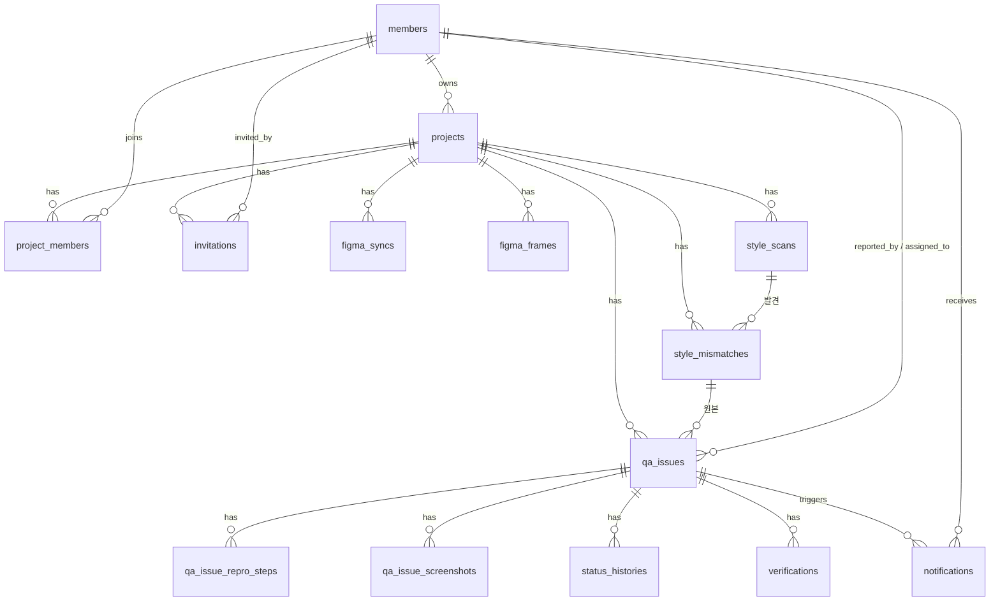

# DB 스키마 (v1 전체)

> v1 API 전체(`docs/openapi.yaml`의 모든 엔드포인트, AC1~AC15)를 구현하는 데 필요한 테이블 설계. 2026-10-28 작성.
> 정본은 JPA 엔티티 코드(`backend/src/main/java/com/acjb/server/domain/`)이고, 이 문서는 엔티티를 이 설계에 맞추기 위한 기준이다. 엔티티를 바꾸면 이 문서도 같이 고친다.
> DB는 MySQL 8.4. 공통: PK는 `BIGINT AUTO_INCREMENT`(API에서는 문자열 id로 노출), enum은 `VARCHAR`, 시각은 `DATETIME(6)` UTC.

## 1. 관계도

## 2. 테이블 요약 (15개 + 2026-11-07 설계 2개)

| 테이블 | 역할 | 관련 API / AC |
| --- | --- | --- |
| `projects` | 프로젝트 | `GET /projects` · AC15 |
| `members` | 팀원(구글 이메일로 식별) | 로그인 매핑 · AC12 |
| `project_members` | 프로젝트-멤버 N:M + 프로젝트별 역할 | `GET /projects/{id}/members` · AC12, AC15, AC19 |
| `invitations` | 구글 이메일 초대 | `/projects/{id}/invitations`, `/invitations/**` · AC17, AC18 |
| `qa_issues` | QA 이슈 본체 | 이슈 CRUD · AC1, AC6, AC11, AC13 |
| `qa_issue_repro_steps` | 재현 절차(순서 있음) | AC1, AC5 |
| `qa_issue_screenshots` | 스크린샷 URL | 이슈 등록 |
| `status_histories` | 상태 변경 이력 | AC6 |
| `verifications` | 재검증 기록 | 재검증 등록·조회 · AC4, AC5 |
| `notifications` | 앱 내 알림 | AC3, AC4, AC11, AC14 |
| `figma_syncs` | Figma 동기화 작업 | `POST/GET /figma/sync` |
| `figma_frames` | 동기화된 프레임 | `GET /figma/frames` |
| `style_scans` | scan 작업 | `POST/GET /style-mismatches/scan(s)` |
| `style_mismatches` | 스타일 차이(수동·scan 공통) | `GET /style-mismatches` 목록·상세 · AC2 |
| `embeddings` | 재검증 범위 제안 검색용 벡터 (`V2__embeddings.sql`) | `POST .../recheck-suggestions` · AC20 |
| `project_runs` | 비교 분석·첫 QA 실행 기록 (2026-11-07 설계, V4 예정) | `/analysis`, `/first-qa` · AC22, AC23 |
| `design_code_mappings` | Figma 노드 ↔ 코드 위치 매핑 (2026-11-07 설계, 형태는 스파이크 후 확정, V4 예정) | AC22, AC23 |

(`github_issue_url` 등 GitHub 이슈·PR 컬럼은 v1 비포함이라 만들지 않는다. 저장소 연결 컬럼(`projects.github_*`)은 2026-11-07부터 있다. 세션은 서버 메모리 — 별도 테이블 없음.)

## 3. 테이블 정의

### projects
| 컬럼 | 타입 | 제약 | 비고 |
| --- | --- | --- | --- |
| id | BIGINT | PK | |
| name | VARCHAR(100) | NOT NULL | 사용자가 만드는 이름이라 UNIQUE를 두지 않는다(2026-11-04). 규칙(2~40자·허용 문자)은 서비스에서 검사 |
| description | VARCHAR(200) | NULL | 선택(2026-11-07, V5) |
| owner_id | BIGINT | FK→members, NOT NULL | 소유자. 만든 사람(AC16). 멤버 제거는 소유자만(AC19) |
| figma_url | VARCHAR(500) | NULL | 연결한 Figma 페이지 링크(AC21). 접근 확인에 성공했을 때만 채운다 — figma_* 컬럼은 함께 채워지고 함께 비어 있다 |
| figma_file_key | VARCHAR(100) | NULL | 링크에서 뽑은 파일 키 |
| figma_file_name | VARCHAR(255) | NULL | Figma API가 돌려준 파일 이름 |
| figma_page_id | VARCHAR(50) | NULL | 분석할 페이지 노드 id(예 `424:2`) — 2026-11-07, V6 |
| figma_page_name | VARCHAR(255) | NULL | 그 페이지 이름 |
| figma_connected_at | DATETIME(6) | NULL | |
| github_url | VARCHAR(500) | NULL | 연결한 공개 저장소 링크(AC21) — github_* 넷도 함께 채워진다 |
| github_repo | VARCHAR(200) | NULL | `owner/repo` |
| github_default_branch | VARCHAR(100) | NULL | 접근 확인 때 받은 기본 브랜치. 분석·첫 QA는 그 시점 커밋을 읽는다 |
| github_connected_at | DATETIME(6) | NULL | |
| created_at | DATETIME(6) | NOT NULL | |

비교 분석이 성공한 뒤에는 링크를 바꿀 수 없다(409, AC21) — 매핑이 가리키는 파일·노드가 바뀌기 때문.

### members
| 컬럼 | 타입 | 제약 | 비고 |
| --- | --- | --- | --- |
| id | BIGINT | PK | |
| email | VARCHAR(255) | NOT NULL, **UNIQUE** | 구글 로그인 이메일 |
| name | VARCHAR(50) | NOT NULL | 구글 계정 이름 |
| created_at | DATETIME(6) | NOT NULL | 처음 로그인한 시각 |

`role`은 2026-11-04부터 `project_members`로 옮겼다 — 같은 사람이 프로젝트마다 다른 역할일 수 있다.

### project_members
| 컬럼 | 타입 | 제약 | 비고 |
| --- | --- | --- | --- |
| id | BIGINT | PK | |
| project_id | BIGINT | FK→projects, NOT NULL | |
| member_id | BIGINT | FK→members, NOT NULL | |
| role | VARCHAR(20) | **NULL** | designer / frontend / backend / planner — 이 프로젝트에서의 역할. 초대받은 사람은 수락할 때 고르고, 만든 사람은 NULL(미지정)로 시작한다. 이후 변경은 소유자만(2026-11-07, V5에서 NULL 허용) |
| joined_at | DATETIME(6) | NOT NULL | |
| | | **UNIQUE(project_id, member_id)** | 중복 가입 방지 |

멤버를 제거하면 이 행을 지운다(AC19). 그 사람이 남긴 이슈·이력·알림·재검증은 지우지 않는다(N15).

### invitations
| 컬럼 | 타입 | 제약 | 비고 |
| --- | --- | --- | --- |
| id | BIGINT | PK | |
| project_id | BIGINT | FK→projects, NOT NULL | |
| email | VARCHAR(255) | NOT NULL | 초대받은 구글 이메일(소문자). 수락할 때 로그인 이메일과 같아야 한다(AC18) |
| token_hash | CHAR(64) | NOT NULL, **UNIQUE** | 수락 링크 토큰의 SHA-256. 원문 토큰은 메일에만 있고 DB·로그·응답에 남기지 않는다(N14) |
| status | VARCHAR(10) | NOT NULL | pending / accepted / canceled / expired |
| invited_by_id | BIGINT | FK→members, NOT NULL | |
| expires_at | DATETIME(6) | NOT NULL | 만든 시각 + 7일. 재전송하면 재전송 시각 + 7일 |
| created_at | DATETIME(6) | NOT NULL | |
| accepted_at | DATETIME(6) | NULL | |
| accepted_member_id | BIGINT | FK→members, NULL | 수락한 멤버 |

만료는 조회·수락할 때 `expires_at`으로 판정한다(배치 작업 없이). 같은 이메일로 다시 초대하거나 재전송하면 새 행을 만들지 않고 그 pending 행의 `token_hash`와 `expires_at`을 바꾼다 — 이전 링크는 무효가 된다(AC17, 2026-11-07. 이전에는 canceled로 바꾸고 새 행을 만들었다).

### qa_issues
| 컬럼 | 타입 | 제약 | 비고 |
| --- | --- | --- | --- |
| id | BIGINT | PK | |
| project_id | BIGINT | FK, NOT NULL | |
| description | TEXT | NOT NULL | AC1 |
| screen_location | VARCHAR(255) | NOT NULL | AC1 |
| platform_scope | VARCHAR(10) | NOT NULL | common / aos / ios (AC1) |
| env_platform | VARCHAR(10) | NULL | aos / ios / web (Environment) |
| env_device | VARCHAR(100) | NULL | |
| env_browser | VARCHAR(100) | NULL | |
| env_deploy_stage | VARCHAR(10) | NULL | local / staging / production |
| figma_link | VARCHAR(500) | NULL | |
| style_mismatch_id | BIGINT | FK→style_mismatches, NULL | 스타일 차이 이슈일 때만. 수동 입력도 mismatch 행을 만들어 연결. source=first_qa면 NOT NULL(서비스에서 검사) |
| status | VARCHAR(20) | NOT NULL, default needs_check | needs_check / in_progress / fixed / needs_recheck / resolved (in_progress 2026-11-07) |
| source | VARCHAR(10) | NOT NULL, default manual | manual / first_qa (2026-11-07) |
| first_qa_run_id | BIGINT | FK→project_runs, NULL | source=first_qa일 때 만든 실행 |
| reported_by_id | BIGINT | FK→members, NOT NULL | 등록자(로그인 사용자) |
| assigned_to_id | BIGINT | FK→members, NULL | 담당자(고치는 사람). 프로젝트 멤버만(AC13) |
| created_at / updated_at | DATETIME(6) | NOT NULL | |

### qa_issue_repro_steps
| 컬럼 | 타입 | 제약 | 비고 |
| --- | --- | --- | --- |
| qa_issue_id | BIGINT | FK, NOT NULL | |
| step_order | INT | NOT NULL | 0부터. **PK(qa_issue_id, step_order)** |
| step | VARCHAR(500) | NOT NULL | AC5: 등록 때 값을 그대로 반환. 최소 1개(AC1) |

### qa_issue_screenshots
| 컬럼 | 타입 | 제약 | 비고 |
| --- | --- | --- | --- |
| qa_issue_id | BIGINT | FK, NOT NULL | |
| position | INT | NOT NULL | **PK(qa_issue_id, position)** |
| url | VARCHAR(1000) | NOT NULL | |

### status_histories
| 컬럼 | 타입 | 제약 | 비고 |
| --- | --- | --- | --- |
| id | BIGINT | PK | |
| qa_issue_id | BIGINT | FK, NOT NULL | |
| status | VARCHAR(20) | NOT NULL | 바뀐 뒤 상태 |
| changed_by_id | BIGINT | FK→members, NOT NULL | |
| changed_at | DATETIME(6) | NOT NULL | 등록 시점의 needs_check도 1건 기록 |

### verifications
| 컬럼 | 타입 | 제약 | 비고 |
| --- | --- | --- | --- |
| id | BIGINT | PK | |
| qa_issue_id | BIGINT | FK, NOT NULL | |
| result | VARCHAR(10) | NOT NULL | pass / fail |
| scope | VARCHAR(255) | NULL | |
| verified_by_id | BIGINT | FK→members, NOT NULL | 등록자만, 등록자가 제거됐으면 소유자(AC13) |
| verified_at | DATETIME(6) | NOT NULL | |

### notifications
| 컬럼 | 타입 | 제약 | 비고 |
| --- | --- | --- | --- |
| id | BIGINT | PK | |
| qa_issue_id | BIGINT | FK, NOT NULL | |
| event | VARCHAR(20) | NOT NULL | issue_created / fixed / recheck_failed |
| channel | VARCHAR(20) | NOT NULL, default in_app | |
| recipient_id | BIGINT | FK→members, NOT NULL | API의 `to_member_id` |
| created_at | DATETIME(6) | NOT NULL | |

읽음 상태는 v1 비포함(SPEC 4절)이라 컬럼 없음. 같은 이벤트가 이슈 한 건에 여러 번 생길 수 있어(담당자 변경, 재검증 반복) UNIQUE 제약은 두지 않는다 — "정확히 1건"은 서비스 로직과 테스트(AC3·4·11)로 보장한다.

### figma_syncs
| 컬럼 | 타입 | 제약 | 비고 |
| --- | --- | --- | --- |
| id | BIGINT | PK | `sync_id` |
| project_id | BIGINT | FK, NOT NULL | |
| figma_file_key | VARCHAR(100) | NOT NULL | |
| frame_ids | JSON | NULL | null이면 전체 동기화 |
| status | VARCHAR(10) | NOT NULL | queued / running / done / failed |
| frame_count | INT | NOT NULL, default 0 | |
| error_message | VARCHAR(500) | NULL | failed일 때 |
| requested_by_id | BIGINT | FK→members, NOT NULL | |
| created_at | DATETIME(6) | NOT NULL | |
| finished_at | DATETIME(6) | NULL | |

### figma_frames
| 컬럼 | 타입 | 제약 | 비고 |
| --- | --- | --- | --- |
| id | BIGINT | PK | |
| project_id | BIGINT | FK, NOT NULL | |
| frame_id | VARCHAR(50) | NOT NULL | Figma 노드 ID (예 `84:759`) — API의 `frame_id` |
| figma_file_key | VARCHAR(100) | NOT NULL | |
| name | VARCHAR(255) | NOT NULL | |
| frame_url | VARCHAR(500) | NOT NULL | |
| last_synced_at | DATETIME(6) | NOT NULL | |
| | | **UNIQUE(project_id, frame_id)** | 재동기화는 upsert |

### style_scans
| 컬럼 | 타입 | 제약 | 비고 |
| --- | --- | --- | --- |
| id | BIGINT | PK | `scan_id` |
| project_id | BIGINT | FK, NOT NULL | |
| frame_id | VARCHAR(50) | NOT NULL | 동기화된 프레임이어야 함(검증은 서비스) |
| node_id | VARCHAR(50) | NOT NULL | |
| target_url | VARCHAR(1000) | NOT NULL | |
| selector | VARCHAR(500) | NOT NULL | |
| status | VARCHAR(10) | NOT NULL | queued / running / done / failed |
| mismatch_count | INT | NOT NULL, default 0 | |
| error_message | VARCHAR(500) | NULL | |
| requested_by_id | BIGINT | FK→members, NOT NULL | |
| created_at / finished_at | DATETIME(6) | NOT NULL / NULL | |

### style_mismatches
| 컬럼 | 타입 | 제약 | 비고 |
| --- | --- | --- | --- |
| id | BIGINT | PK | `mismatchId` |
| project_id | BIGINT | FK, NOT NULL | |
| source | VARCHAR(10) | NOT NULL | manual(사람 입력) / scan / first_qa(2026-11-07) |
| scan_id | BIGINT | FK→style_scans, NULL | source=scan일 때 |
| code_path | VARCHAR(500) | NULL | source=first_qa일 때 actual_value를 확인한 파일 경로(N17) |
| code_line | INT | NULL | 그 파일의 줄 번호 |
| frame_id | VARCHAR(50) | NULL | 기준 Figma 프레임(목록 필터용). figma_frames와 논리 참조 |
| node_id | VARCHAR(50) | NULL | scan일 때 |
| screen | VARCHAR(1000) | NULL | 비교한 화면(scan이면 target_url) |
| selector | VARCHAR(500) | NULL | scan일 때 |
| property | VARCHAR(20) | NOT NULL | color / font_weight / font_family / radius / shadow / spacing / text |
| expected_value | VARCHAR(255) | **NOT NULL** | AC2 |
| actual_value | VARCHAR(255) | **NOT NULL** | AC2 |
| created_at | DATETIME(6) | NOT NULL | |

`expected_value`/`actual_value`를 NOT NULL로 두어 DB 차원에서도 AC2(둘 중 하나라도 없으면 저장 금지)를 막는다. `frame_id`는 figma_frames에 FK를 걸지 않는다 — 수동 입력은 동기화하지 않은 프레임을 가리킬 수 있고, 프레임이 재동기화돼도 차이 기록은 남아야 하기 때문.

### embeddings (2026-11-06 설계 확정 — 구현 때 `V2__embeddings.sql`로 추가)
| 컬럼 | 타입 | 제약 | 비고 |
| --- | --- | --- | --- |
| id | BIGINT | PK | |
| project_id | BIGINT | FK→projects, NOT NULL | 검색 범위. 다른 프로젝트 문서를 쓰지 않는 근거(N16) |
| source_type | VARCHAR(20) | NOT NULL, CHECK | qa_issue / style_mismatch / verification |
| source_id | BIGINT | NOT NULL | 원본 행 id. FK 없음(다형 참조) |
| model | VARCHAR(40) | NOT NULL | 예 `voyage-4` |
| vector | BLOB | NOT NULL | float32 1024개, little-endian(4KB) |
| created_at | DATETIME(6) | NOT NULL | |

임베딩 텍스트 규칙·대상(`verification`은 fail만)·생성 시점은 `docs/design-recheck-suggestions.md` 3·4절. 원본 셋 다 생성 후 텍스트가 바뀌지 않아 갱신 컬럼은 두지 않는다. `source_id`에 FK를 걸지 않는 이유: 세 테이블을 가리키고, 원본은 v1에서 삭제되지 않는다. 모델을 바꾸면 `model`이 달라 새 행이 생기고 검색은 현재 모델 행만 쓴다. 제안 결과는 저장하지 않으므로(2026-11-06) 제안용 테이블은 없다.

### project_runs (2026-11-07 설계 — V4 예정)
| 컬럼 | 타입 | 제약 | 비고 |
| --- | --- | --- | --- |
| id | BIGINT | PK | |
| project_id | BIGINT | FK→projects, NOT NULL | |
| kind | VARCHAR(10) | NOT NULL, CHECK | analysis / first_qa |
| status | VARCHAR(10) | NOT NULL, CHECK | queued / running / succeeded / failed |
| requested_by_id | BIGINT | FK→members, NOT NULL | 소유자 |
| commit_sha | VARCHAR(40) | NULL | 읽은 GitHub 커밋 |
| created_count | INT | NOT NULL, default 0 | analysis면 매핑 수, first_qa면 만든 이슈 수 |
| dropped_count | INT | NOT NULL, default 0 | 근거가 모자라 버린 수(N17) |
| error_message | VARCHAR(500) | NULL | 사용자에게 보여 줄 실패 사유. 내부 상세·토큰은 담지 않는다 |
| created_at / finished_at | DATETIME(6) | NOT NULL / NULL | |

같은 프로젝트·kind에 queued/running 행이 있으면 새로 만들지 않고(409), first_qa는 succeeded가 하나라도 있으면 새로 만들지 않는다(AC23). first_qa가 실패하면 그 실행으로 만든 이슈·스타일 차이를 한 트랜잭션으로 되돌린다(N17 — 일부만 남기지 않는다). `ProjectDetail`의 `analysis_status`·`first_qa_status`는 kind별 최근 행의 status(없으면 none).

### design_code_mappings (2026-11-07 설계 — 컬럼은 스파이크 후 확정, V4 예정)
| 컬럼 | 타입 | 제약 | 비고 |
| --- | --- | --- | --- |
| id | BIGINT | PK | |
| project_id | BIGINT | FK→projects, NOT NULL | 다른 프로젝트 매핑을 쓰지 않는 근거(N17) |
| run_id | BIGINT | FK→project_runs, NOT NULL | 만든 비교 분석 실행 |
| frame_id / frame_name | VARCHAR(50) / VARCHAR(255) | NOT NULL | Figma 프레임 |
| node_id / node_name | VARCHAR(50) / VARCHAR(255) | NOT NULL | Figma 노드 |
| code_path | VARCHAR(500) | NOT NULL | 저장소 안 파일 경로 |
| code_symbol | VARCHAR(255) | NULL | 컴포넌트·클래스 이름 |
| created_at | DATETIME(6) | NOT NULL | |

## 4. 인덱스 (목록 정렬·조회용)

| 테이블 | 인덱스 | 이유 |
| --- | --- | --- |
| qa_issues | (project_id, created_at DESC, id DESC) | 이슈 목록 고정 정렬 |
| qa_issues | (project_id, status) | 상태 필터 |
| qa_issues | (assigned_to_id), (reported_by_id) | 담당자·등록자 필터 |
| notifications | (recipient_id, created_at DESC, id DESC) | AC14 내 알림 최신순 |
| status_histories | (qa_issue_id, changed_at, id) | 이력 시간순 |
| verifications | (qa_issue_id, verified_at DESC, id DESC) | 재검증 목록 |
| style_mismatches | (project_id, created_at DESC, id DESC), (project_id, frame_id), (project_id, property) | 목록 + 필터 |
| figma_frames | UNIQUE(project_id, frame_id) | upsert |
| project_members | UNIQUE(project_id, member_id) | AC12 멤버 확인 |
| invitations | UNIQUE(token_hash) | 수락 링크로 찾기 |
| invitations | (project_id, status, created_at DESC, id DESC) | 프로젝트의 대기 초대 목록 |
| invitations | (email, status) | `GET /invitations/mine`, 같은 이메일 재초대 |
| embeddings | UNIQUE(source_type, source_id, model) | 같은 원본 중복 생성 방지, 누락분 찾기 |
| embeddings | (project_id, model) | 프로젝트 문서만 읽어 유사도 계산 |
| project_runs | (project_id, kind, created_at DESC, id DESC) | kind별 최근 실행 |
| design_code_mappings | (project_id, run_id) | 첫 QA가 매핑을 읽을 때 |
| qa_issues | (project_id, source) | 첫 QA 결과 목록(`source=first_qa`) |

## 5. 엔티티 반영 상태

2026-11-04에 엔티티를 이 설계에 맞췄다(`server-feat-schema-align` `a78192f`, 아직 `server`에 병합 전). 1~4절과 실제 MySQL DDL이 같다는 것을 `qating_test` 스키마에서 `information_schema`로 대조해 확인했다(13개 테이블의 컬럼 타입·NULL 여부, FK, 4절 인덱스).

반영한 것:

1. **신규 4개 테이블**: `figma_syncs`, `figma_frames`, `style_scans`, `style_mismatches` — 엔티티·Repository·enum `JobStatus`, `MismatchSource` 추가.
2. **`qa_issues` 변경**: 임베드 `mismatch_*` 컬럼을 없애고 `style_mismatch_id` FK로 교체. 사람이 입력한 차이도 `StyleMismatch.manual()`로 행을 먼저 만들어 연결하고, scan 결과는 `StyleMismatch.fromScan()`으로 만든다.
3. **인덱스**: 4절 전부. 목록 정렬용 인덱스는 MySQL 8 내림차순 인덱스(`created_at DESC, id DESC`)로 만든다.
4. **컬럼 명세 정렬**: Environment 컬럼명 `env_*`, `qa_issue_repro_steps.step` 500, `qa_issue_screenshots`의 `position`·`url` 1000, `projects`·`members`의 `created_at`, 각 컬럼 길이.
5. `StyleProperty` enum은 그대로 재사용.

구현 메모:

- **enum은 `VARCHAR`로 고정한다.** Hibernate는 `@Enumerated(EnumType.STRING)`을 MySQL에서 native `ENUM` 타입으로 만든다. 그러면 값을 추가할 때마다 컬럼 타입 `ALTER`가 필요하므로, enum 필드마다 `@JdbcTypeCode(SqlTypes.VARCHAR)`를 붙인다. 새 enum 필드를 추가할 때도 같이 붙일 것. 다만 VARCHAR 컬럼에도 허용 값 CHECK 제약(예: `qa_issues_chk_4`)이 걸려 있어, enum 값을 추가하면 그 제약을 바꾸는 마이그레이션 파일이 필요하다.
- **스키마는 Flyway로만 바꾼다(2026-11-05).** 테이블은 서버가 켜질 때 `backend/src/main/resources/db/migration/V*.sql`이 순서대로 적용돼 만들어지고, Hibernate는 `ddl-auto: validate`로 엔티티와 맞는지 검사만 한다. 스키마를 바꾸려면 엔티티와 함께 새 파일 `V2__설명.sql`(다음 번호)을 추가한다 — 이미 적용된 V 파일은 고치지 않는다. Flyway 도입 전에 만든 로컬 DB는 기록 테이블이 없어 서버가 뜨지 않으므로 로컬 `qating` 스키마를 비우고 다시 띄운다(시드는 2026-11-04 폐기 — 프로젝트·멤버는 앱에서 만든다).
- **`projects.name` UNIQUE**: 시드 로더가 이름으로 프로젝트를 찾느라 엔티티에 남겨 두었으나, 2026-11-04 시드 폐기·사용자 생성 프로젝트로 바뀌어 제거 대상이다(아래 추가 목표 1번).
- **`GET /figma/frames` 목록 정렬**: `openapi.yaml`에 정렬 기준이 없어 목록 조회 메서드는 아직 만들지 않았다(AGENTS.md 5절). 구현 전에 정렬 기준을 정해야 한다.

### 2026-11-04 추가 목표 (아직 엔티티 미반영)

프로젝트 생성·초대 결정(decision_log 2026-11-04)으로 다음을 엔티티에 반영해야 한다.

1. `projects.owner_id` 추가, `projects.name`의 UNIQUE 제거
2. `members.role` 제거 → `project_members.role`·`joined_at` 추가
3. `invitations` 테이블 신규
4. CSV 시드 로더(`SeedLoader`)와 `data/seed/members*.csv` 제거 — Member는 처음 로그인할 때 만든다

## 6. 의도적으로 두지 않은 것

- 알림 읽음 상태, 이메일·Slack 채널 — v2
- GitHub 연동 컬럼 — v1 비포함
- Screen 테이블 — scan이 `target_url`·`selector`를 직접 받으므로 불필요(`style_mismatches.screen`에 문자열로 보관)
- 초대 거절 기록 — v1은 수락만 다룬다(거절하면 그냥 두고 7일 뒤 만료)
- 세션·토큰 테이블 — 세션은 서버 메모리. 배포 시 다중 인스턴스가 되면 그때 Spring Session 도입 검토
- 감사 로그 별도 테이블 — `status_histories`가 상태 변경의 감사 로그 역할
