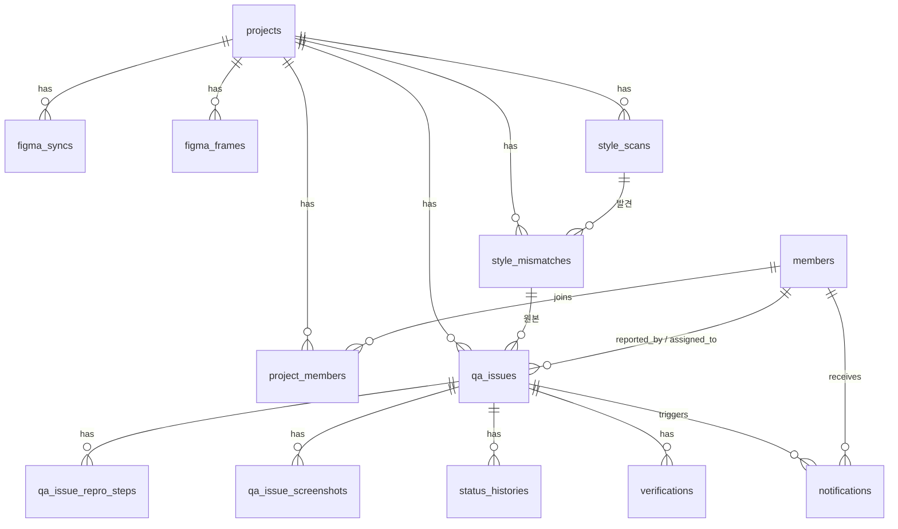

# DB 스키마 (v1 전체)

> v1 API 전체(`docs/openapi.yaml`의 모든 엔드포인트, AC1~AC15)를 구현하는 데 필요한 테이블 설계. 2026-10-28 작성.
> 정본은 JPA 엔티티 코드(`backend/src/main/java/com/acjb/server/domain/`)이고, 이 문서는 엔티티를 이 설계에 맞추기 위한 기준이다. 엔티티를 바꾸면 이 문서도 같이 고친다.
> DB는 MySQL 8.4. 공통: PK는 `BIGINT AUTO_INCREMENT`(API에서는 문자열 id로 노출), enum은 `VARCHAR`, 시각은 `DATETIME(6)` UTC.

## 1. 관계도

## 2. 테이블 요약 (13개)

| 테이블 | 역할 | 관련 API / AC |
| --- | --- | --- |
| `projects` | 프로젝트 | `GET /projects` · AC15 |
| `members` | 팀원(구글 이메일로 식별) | 로그인 매핑 · AC12 |
| `project_members` | 프로젝트-멤버 N:M | `GET /projects/{id}/members` · AC12, AC15 |
| `qa_issues` | QA 이슈 본체 | 이슈 CRUD · AC1, AC6, AC11, AC13 |
| `qa_issue_repro_steps` | 재현 절차(순서 있음) | AC1, AC5 |
| `qa_issue_screenshots` | 스크린샷 URL | 이슈 등록 |
| `status_histories` | 상태 변경 이력 | AC6 |
| `verifications` | 재검증 기록 | 재검증 등록·조회 · AC4, AC5 |
| `notifications` | 앱 내 알림 | AC3, AC4, AC11, AC14 |
| `figma_syncs` | Figma 동기화 작업 | `POST/GET /figma/sync` |
| `figma_frames` | 동기화된 프레임 | `GET /figma/frames` |
| `style_scans` | scan 작업 | `POST/GET /style-mismatches/scan(s)` |
| `style_mismatches` | 스타일 차이(수동·scan 공통) | `GET /style-mismatches` 목록·상세 · AC2 |

(`github_*` 컬럼은 v1 비포함이라 만들지 않는다. 세션은 서버 메모리 — 별도 테이블 없음.)

## 3. 테이블 정의

### projects
| 컬럼 | 타입 | 제약 | 비고 |
| --- | --- | --- | --- |
| id | BIGINT | PK | |
| name | VARCHAR(100) | NOT NULL | |
| created_at | DATETIME(6) | NOT NULL | |

### members
| 컬럼 | 타입 | 제약 | 비고 |
| --- | --- | --- | --- |
| id | BIGINT | PK | |
| email | VARCHAR(255) | NOT NULL, **UNIQUE** | 구글 로그인 이메일 |
| name | VARCHAR(50) | NOT NULL | |
| role | VARCHAR(20) | NOT NULL | designer / developer / planner |
| created_at | DATETIME(6) | NOT NULL | |

### project_members
| 컬럼 | 타입 | 제약 | 비고 |
| --- | --- | --- | --- |
| id | BIGINT | PK | |
| project_id | BIGINT | FK→projects, NOT NULL | |
| member_id | BIGINT | FK→members, NOT NULL | |
| | | **UNIQUE(project_id, member_id)** | 중복 가입 방지 |

### qa_issues
| 컬럼 | 타입 | 제약 | 비고 |
| --- | --- | --- | --- |
| id | BIGINT | PK | |
| project_id | BIGINT | FK, NOT NULL | |
| description | TEXT | NOT NULL | AC1 |
| screen_location | VARCHAR(255) | NOT NULL | AC1 |
| platform_scope | VARCHAR(10) | NOT NULL | common / aos / ios (AC1) |
| env_platform | VARCHAR(10) | NULL | aos / ios / web (Environment) |
| env_device | VARCHAR(100) | NULL | |
| env_browser | VARCHAR(100) | NULL | |
| env_deploy_stage | VARCHAR(10) | NULL | local / staging / production |
| figma_link | VARCHAR(500) | NULL | |
| style_mismatch_id | BIGINT | FK→style_mismatches, NULL | 스타일 차이 이슈일 때만. 수동 입력도 mismatch 행을 만들어 연결 |
| status | VARCHAR(20) | NOT NULL, default needs_check | needs_check / fixed / needs_recheck / resolved |
| reported_by_id | BIGINT | FK→members, NOT NULL | 등록자(로그인 사용자) |
| assigned_to_id | BIGINT | FK→members, NULL | 담당자(고치는 사람). 프로젝트 멤버만(AC13) |
| created_at / updated_at | DATETIME(6) | NOT NULL | |

### qa_issue_repro_steps
| 컬럼 | 타입 | 제약 | 비고 |
| --- | --- | --- | --- |
| qa_issue_id | BIGINT | FK, NOT NULL | |
| step_order | INT | NOT NULL | 0부터. **PK(qa_issue_id, step_order)** |
| step | VARCHAR(500) | NOT NULL | AC5: 등록 때 값을 그대로 반환. 최소 1개(AC1) |

### qa_issue_screenshots
| 컬럼 | 타입 | 제약 | 비고 |
| --- | --- | --- | --- |
| qa_issue_id | BIGINT | FK, NOT NULL | |
| position | INT | NOT NULL | **PK(qa_issue_id, position)** |
| url | VARCHAR(1000) | NOT NULL | |

### status_histories
| 컬럼 | 타입 | 제약 | 비고 |
| --- | --- | --- | --- |
| id | BIGINT | PK | |
| qa_issue_id | BIGINT | FK, NOT NULL | |
| status | VARCHAR(20) | NOT NULL | 바뀐 뒤 상태 |
| changed_by_id | BIGINT | FK→members, NOT NULL | |
| changed_at | DATETIME(6) | NOT NULL | 등록 시점의 needs_check도 1건 기록 |

### verifications
| 컬럼 | 타입 | 제약 | 비고 |
| --- | --- | --- | --- |
| id | BIGINT | PK | |
| qa_issue_id | BIGINT | FK, NOT NULL | |
| result | VARCHAR(10) | NOT NULL | pass / fail |
| scope | VARCHAR(255) | NULL | |
| verified_by_id | BIGINT | FK→members, NOT NULL | 등록자만(AC13) |
| verified_at | DATETIME(6) | NOT NULL | |

### notifications
| 컬럼 | 타입 | 제약 | 비고 |
| --- | --- | --- | --- |
| id | BIGINT | PK | |
| qa_issue_id | BIGINT | FK, NOT NULL | |
| event | VARCHAR(20) | NOT NULL | issue_created / fixed / recheck_failed |
| channel | VARCHAR(20) | NOT NULL, default in_app | |
| recipient_id | BIGINT | FK→members, NOT NULL | API의 `to_member_id` |
| created_at | DATETIME(6) | NOT NULL | |

읽음 상태는 v1 비포함(SPEC 4절)이라 컬럼 없음. 같은 이벤트가 이슈 한 건에 여러 번 생길 수 있어(담당자 변경, 재검증 반복) UNIQUE 제약은 두지 않는다 — "정확히 1건"은 서비스 로직과 테스트(AC3·4·11)로 보장한다.

### figma_syncs
| 컬럼 | 타입 | 제약 | 비고 |
| --- | --- | --- | --- |
| id | BIGINT | PK | `sync_id` |
| project_id | BIGINT | FK, NOT NULL | |
| figma_file_key | VARCHAR(100) | NOT NULL | |
| frame_ids | JSON | NULL | null이면 전체 동기화 |
| status | VARCHAR(10) | NOT NULL | queued / running / done / failed |
| frame_count | INT | NOT NULL, default 0 | |
| error_message | VARCHAR(500) | NULL | failed일 때 |
| requested_by_id | BIGINT | FK→members, NOT NULL | |
| created_at | DATETIME(6) | NOT NULL | |
| finished_at | DATETIME(6) | NULL | |

### figma_frames
| 컬럼 | 타입 | 제약 | 비고 |
| --- | --- | --- | --- |
| id | BIGINT | PK | |
| project_id | BIGINT | FK, NOT NULL | |
| frame_id | VARCHAR(50) | NOT NULL | Figma 노드 ID (예 `84:759`) — API의 `frame_id` |
| figma_file_key | VARCHAR(100) | NOT NULL | |
| name | VARCHAR(255) | NOT NULL | |
| frame_url | VARCHAR(500) | NOT NULL | |
| last_synced_at | DATETIME(6) | NOT NULL | |
| | | **UNIQUE(project_id, frame_id)** | 재동기화는 upsert |

### style_scans
| 컬럼 | 타입 | 제약 | 비고 |
| --- | --- | --- | --- |
| id | BIGINT | PK | `scan_id` |
| project_id | BIGINT | FK, NOT NULL | |
| frame_id | VARCHAR(50) | NOT NULL | 동기화된 프레임이어야 함(검증은 서비스) |
| node_id | VARCHAR(50) | NOT NULL | |
| target_url | VARCHAR(1000) | NOT NULL | |
| selector | VARCHAR(500) | NOT NULL | |
| status | VARCHAR(10) | NOT NULL | queued / running / done / failed |
| mismatch_count | INT | NOT NULL, default 0 | |
| error_message | VARCHAR(500) | NULL | |
| requested_by_id | BIGINT | FK→members, NOT NULL | |
| created_at / finished_at | DATETIME(6) | NOT NULL / NULL | |

### style_mismatches
| 컬럼 | 타입 | 제약 | 비고 |
| --- | --- | --- | --- |
| id | BIGINT | PK | `mismatchId` |
| project_id | BIGINT | FK, NOT NULL | |
| source | VARCHAR(10) | NOT NULL | manual(사람 입력) / scan |
| scan_id | BIGINT | FK→style_scans, NULL | source=scan일 때 |
| frame_id | VARCHAR(50) | NULL | 기준 Figma 프레임(목록 필터용). figma_frames와 논리 참조 |
| node_id | VARCHAR(50) | NULL | scan일 때 |
| screen | VARCHAR(1000) | NULL | 비교한 화면(scan이면 target_url) |
| selector | VARCHAR(500) | NULL | scan일 때 |
| property | VARCHAR(20) | NOT NULL | color / font_weight / font_family / radius / shadow / spacing / text |
| expected_value | VARCHAR(255) | **NOT NULL** | AC2 |
| actual_value | VARCHAR(255) | **NOT NULL** | AC2 |
| created_at | DATETIME(6) | NOT NULL | |

`expected_value`/`actual_value`를 NOT NULL로 두어 DB 차원에서도 AC2(둘 중 하나라도 없으면 저장 금지)를 막는다. `frame_id`는 figma_frames에 FK를 걸지 않는다 — 수동 입력은 동기화하지 않은 프레임을 가리킬 수 있고, 프레임이 재동기화돼도 차이 기록은 남아야 하기 때문.

## 4. 인덱스 (목록 정렬·조회용)

| 테이블 | 인덱스 | 이유 |
| --- | --- | --- |
| qa_issues | (project_id, created_at DESC, id DESC) | 이슈 목록 고정 정렬 |
| qa_issues | (project_id, status) | 상태 필터 |
| qa_issues | (assigned_to_id), (reported_by_id) | 담당자·등록자 필터 |
| notifications | (recipient_id, created_at DESC, id DESC) | AC14 내 알림 최신순 |
| status_histories | (qa_issue_id, changed_at, id) | 이력 시간순 |
| verifications | (qa_issue_id, verified_at DESC, id DESC) | 재검증 목록 |
| style_mismatches | (project_id, created_at DESC, id DESC), (project_id, frame_id), (project_id, property) | 목록 + 필터 |
| figma_frames | UNIQUE(project_id, frame_id) | upsert |
| project_members | UNIQUE(project_id, member_id) | AC12 멤버 확인 |

## 5. 현재 엔티티와의 차이 (구현 시 해야 할 일)

현재 `server-feat-db-domain`의 엔티티는 9개 테이블이다. 목표와 다른 점:

1. **신규 4개 테이블**: `figma_syncs`, `figma_frames`, `style_scans`, `style_mismatches` (+ 엔티티·Repository·enum `JobStatus`, `MismatchSource`).
2. **`qa_issues` 변경**: 임베드된 `mismatch_*` 컬럼(StyleMismatch embeddable)을 제거하고 `style_mismatch_id` FK로 교체.
3. **인덱스 추가**: 4절 전부(현재 없음).
4. `StyleProperty` enum은 그대로 재사용.

## 6. 의도적으로 두지 않은 것

- 알림 읽음 상태, 이메일·Slack 채널 — v2
- GitHub 연동 컬럼 — v1 비포함
- Screen 테이블 — scan이 `target_url`·`selector`를 직접 받으므로 불필요(`style_mismatches.screen`에 문자열로 보관)
- 세션·토큰 테이블 — 세션은 서버 메모리. 배포 시 다중 인스턴스가 되면 그때 Spring Session 도입 검토
- 감사 로그 별도 테이블 — `status_histories`가 상태 변경의 감사 로그 역할
